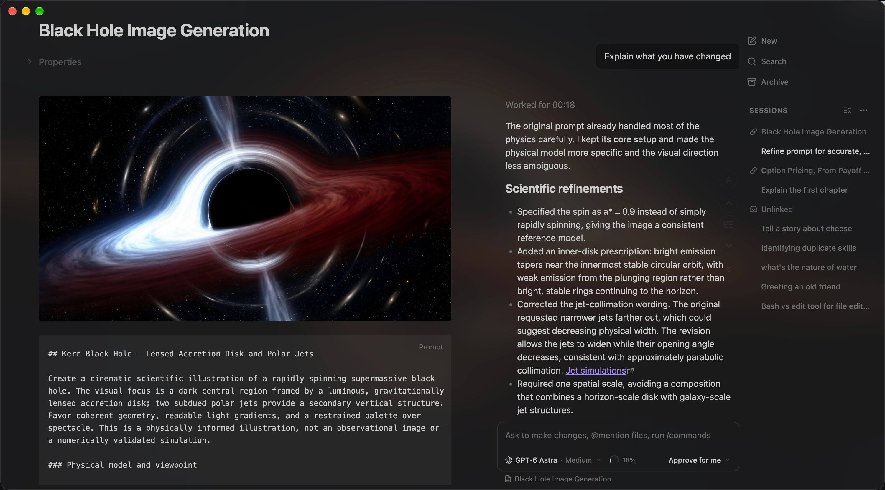

# Claudian (Kaishin)



A personal build of Claudian, an Obsidian plugin that puts AI coding agents in your vault. Supported agents are Claude Code, Codex, Grok Build, Antigravity CLI, OpenCode, Pi and DeepSeek Harness. The vault is the working directory of the agent. The agent can read, write and search files, run commands and do multi-step tasks.

This build is based on [Claudian](https://github.com/YishenTu/claudian) by Yishen Tu, version 2.3.45. It has its own plugin id, `claudian-kaishin`. Obsidian does not connect it to the Community Plugins release, and it does not get updates from that release. You install it only from source.

## Features

Open Claudian from the ribbon icon or the command palette. Talk to the agent, and it reads, writes, edits, searches and runs commands in your vault.

- **Inline Edit**: Select text, or put the cursor where you want, and press the hotkey. The agent edits the note and shows a word-level diff before you accept.
- **Projects**: Group sessions that work toward one goal. All sessions in a project share its instructions and a memory file. The agents can find, read and send messages to each other. See [Projects](docs/projects.md).
- **Zen Mode**: Collapse the sidebar, and the chat moves to a [compact composer](assets/zen-mode-collapsed.png) below your notes. Click to [open the full conversation](assets/zen-mode-expanded.png).
- **Slash commands and skills**: Type `/` or `$` to use prompt templates or skills from user and vault scopes.
- **@mention**: Type `@` to refer to vault files, folders and other Claudian sessions.
- **Cross-session messaging**: Agents can read, message, steer or stop other sessions, and start new ones on any provider. See [Cross-session messaging](docs/cross-session-messaging.md).
- **Side chat (`/side` or `/btw`)**: Start a temporary conversation with tools. The main chat does not change.
- **MCP servers**: Each agent uses the MCP configuration of its own CLI.
- **Tabs and sessions**: Use tabs in [single-pane mode](assets/main-chat-single-pane.png), or keep the session list next to the chat in [dual-pane mode](assets/main-chat-dual-pane.png).
- **Plugin API (experimental)**: Other Obsidian plugins can send prompts to sessions, stop them and read the replies. See [Plugin API](docs/plugin-api.md).

## Requirements

- Obsidian v1.13.0+
- Desktop only (macOS, Linux or Windows)
- Node.js 24 or 26, to build
- One or more of these agent CLIs, with a subscription or an API key:
  - [Antigravity CLI](https://antigravity.google/product/antigravity-cli)
  - [Claude Code](https://code.claude.com/docs/en/overview)
  - [Codex](https://github.com/openai/codex)
  - [DeepSeek Harness](https://github.com/deepseek-ai/deepseek-harness)
  - [Grok Build](https://github.com/xai-org/grok-build)
  - [OpenCode V2](https://github.com/anomalyco/opencode)
  - [Pi](https://github.com/earendil-works/pi)

## Installation

1. Clone the repository and install the dependencies:

   ```bash
   git clone https://github.com/kaishin/claudian.git
   cd claudian
   npm ci
   ```

2. Set your vault path in `.env.local`. `npm ci` creates this file, and git ignores it:

   ```bash
   OBSIDIAN_VAULT=/path/to/your/vault
   ```

3. Build the plugin:

   ```bash
   npm run build
   ```

   The build copies `main.js`, `manifest.json` and `styles.css` to `<vault>/.obsidian/plugins/claudian-kaishin/`.

4. In Obsidian, open Settings → Community plugins and enable **Claudian (Kaishin)**.

If you have the Community Plugins release installed in the same vault, remove it first. The two plugins use the same vault data.

## Development

```bash
npm run dev          # Rebuild on each save and copy to the vault
npm run build:css    # Build styles.css again after you change src/style/
npm run build        # Production build
```

After a rebuild, press Cmd+R (Ctrl+R on Windows and Linux) in Obsidian to load the new build. You can also use the community **Hot Reload** plugin: put an empty `.hotreload` file in the plugin folder. Open the developer tools with Cmd+Opt+I (Ctrl+Shift+I) to see logs.

Run the full checks before you commit:

```bash
npm run typecheck && npm run lint && npm run test && npm run build && npm run check:performance
```

Notes:

- On Node 26, the five tests in `ClaudeTaskResultInterpreter.wsl` fail. Their test helper patches the `fs` module, and Node 26 does not allow this. The plugin code is not affected.
- If you run the tests from a Claude Code session, run `unset CLAUDE_CONFIG_DIR` first. Some history tests read this variable.
- `npm run smoke:obsidian` tests the build in your installed Obsidian app (macOS only). It uses a temporary vault and a sandbox, and it does not change your vaults.
- `AGENTS.md` and the `AGENTS.md` files in the subfolders contain the rules for the code structure and the tests.

## Privacy and data use

- **Data sent to providers**: your input, attached files, images and tool output. The selected agent sends this data to its provider: Anthropic (Claude), OpenAI (Codex), xAI (Grok), Google (Antigravity), or the providers that you configure in OpenCode, Pi or DeepSeek Harness. You set the destination in the provider settings and environment variables.
- **No telemetry**: Claudian sends no telemetry. Its timers only read the local Obsidian and editor state. Network traffic comes only from provider requests, the MCP endpoints that you configure, and a listener on 127.0.0.1 that OpenCode, DeepSeek and Grok sessions use for Claudian's session tools.

## Troubleshooting

See [Troubleshooting](docs/troubleshooting.md) for these problems: a provider CLI or Node.js that the plugin cannot find, a new model that does not show, and authentication that fails while the CLI works.

## Architecture

```
src/
├── main.ts                      # Plugin entry point and sole composition root
├── composition/                 # Host objects and view wiring shared by app and features
├── app/                         # Startup, conversations, settings, and storage
├── core/                        # Provider-neutral execution, registry, and type contracts
│   ├── execution/               # Run, session snapshot, and interaction primitives
│   ├── providers/               # Provider registry and workspace services
│   ├── process/                 # CLI discovery and managed child processes
│   ├── prompt/                  # Prompt and context encoding
│   ├── auxiliary/               # Shared provider auxiliary services
│   └── ...                      # bootstrap, commands, rpc, security, storage, tools, types
├── providers/
│   ├── antigravity/             # Antigravity CLI ACP adaptor, transcript history, models
│   ├── claude/                  # Claude Agent SDK adaptor, native history, plugins
│   ├── codex/                   # Codex shared app-server adaptor, JSON-RPC, JSONL history
│   ├── deepseek/                # DeepSeek Harness native Remote adaptor, presets, and history
│   ├── grok/                    # Grok Build ACP adaptor, native history, models, and tools
│   ├── opencode/                # OpenCode HTTP adaptor, shared server
│   ├── pi/                      # Pi RPC adaptor, model discovery, JSONL history
│   └── acp/                     # Agent Client Protocol shared mechanics
├── features/
│   ├── agent-skills/            # Vault skill and Claude command management
│   ├── chat/                    # Sidebar chat: tabs, workspace lifecycle, controllers, renderers
│   ├── inline-edit/             # Inline edit modal and provider-backed edit services
│   └── settings/                # Settings shell and provider tabs
├── shared/                      # Reusable UI components, settings controls, mention/dropdown
├── i18n/                        # Internationalization (10 locales)
├── utils/                       # Domain-free leaf helpers
└── style/                       # Modular CSS
```

## Credits and license

Claudian was created by [Yishen Tu](https://github.com/YishenTu). This build uses the [MIT License](LICENSE) of the original project, and it keeps the original copyright notice.
